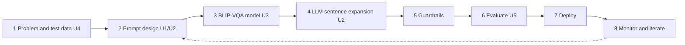

# P34 · Visual Question Answering App

**Student:** Saumya Joshi · **Enrollment:** ADT23SOCB0997 · **Roll No:** 34 · **Class:** AIA-05 Batch B
**Course:** Generative AI – 60 LLM Mini-Projects (CA assessment) · **Track C** (GPT, BERT and multimodal models)

**Goal:** answer questions about an uploaded image.

- **Live app:** https://huggingface.co/spaces/samjocodes/p34-vqa-app
- **GitHub repo:** https://github.com/samjocodes/p34-vqa-app
- **Model card:** [MODEL_CARD.md](MODEL_CARD.md)
- **Measured results (generated by the app, never hand-typed):** [results/results_summary.md](results/results_summary.md) · full PDF report: [results/P34_report_Saumya_Joshi.pdf](results/P34_report_Saumya_Joshi.pdf)



## What it does (U1–U5)

| Unit | Task | Implementation |
|---|---|---|
| U1 | Question templates | `templates.py` – 8 fill-in-the-blank templates, question-type detector |
| U2 | LLM expands terse answers | `llm.py` – Gemini (optional secret) → Qwen2.5-0.5B-Instruct (local) → rule-based; zero-shot vs few-shot compared |
| U3 | Answer with BLIP-VQA | `vqa_model.py` – `Salesforce/blip-vqa-base`, confidence + top-5 probability view |
| U4 | Test images for hard cases | `synth.py` – clean / low-light / cluttered scenes with exact ground truth; optional SD-Turbo |
| U5 | Study low-light & cluttered failures, accessibility | `vqa_eval.py` + `report.py` – 20 image–question pairs, before/after brightening, PDF report |

## Five required layers

| Layer | Where |
|---|---|
| I Foundations | lifecycle diagram (above); generative-vs-discriminative framing + zero/few-shot comparison + probability view (app + report §3) |
| II GANs & LLMs | Transformer LLM (Qwen/Gemini) at core; prompt-based learning compared; attention explanation (report §4) |
| III GPT, BERT, multimodal | GPT-style decoder (Qwen2.5) + BERT-family MiniLM scorer + image modality (BLIP) |
| IV Tools & generation | Python + PyTorch/Transformers; image generation feature (test-image generator, optional SD-Turbo) |
| V Responsible AI | measured bias test + hallucination (faithfulness) test, sensitive-question guardrail, licence/IP note, model card |

## Run locally

```bash
pip install -r requirements.txt
python smoke_test.py     # pre-flight: proves BLIP + the LLM really load (~3 min, do this first)
python app.py            # opens http://127.0.0.1:7860
python vqa_eval.py       # CLI: runs the 20-pair evaluation, writes outputs/results.json + PDF report
VQA_MOCK=1 python tests/test_core.py   # offline unit tests (no model downloads)
python synth.py          # regenerate testset/ (20 benchmark images + 10 bias silhouettes)
```

No local GPU/Python? Open **`P34_colab_V2.ipynb`** in Google Colab — it installs everything,
runs the evaluation and downloads the PDF report.

Optional secret (never commit keys): `GEMINI_API_KEY` (and `GEMINI_MODEL`). Without it the app uses the local Qwen model.

## Responsible use
No sensitive-attribute inference (gender, age, race, religion, health) and no identification of people – such questions are refused. Low-confidence answers are flagged. Uploaded images are processed in memory and not stored. See the model card.
